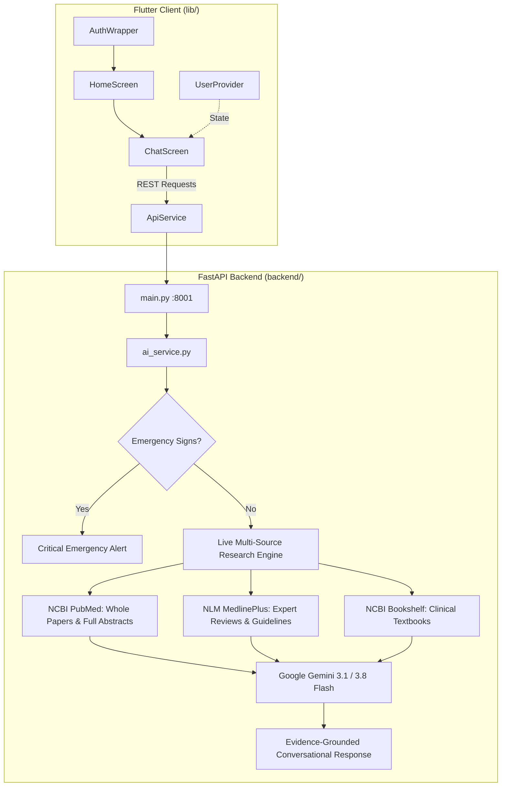

# 🩺 Health Assistant (`Health_Checker`)

[](https://flutter.dev/)
[](https://fastapi.tiangolo.com/)
[](https://ai.google.dev/)
[](https://pubmed.ncbi.nlm.nih.gov/)
[](https://opensource.org/licenses/MIT)

An intelligent, privacy-first AI digital health assistant combining a cross-platform **Flutter** client with a **FastAPI** Python backend. The system integrates real-time biomedical research from **NCBI PubMed** (whole papers & full study abstracts), **NLM MedlinePlus** expert guidelines, and **NCBI Bookshelf** clinical textbooks, synthesizing evidence-grounded medical triage using **Google Gemini AI**.

---

## 🌟 Key Features

- **Evidence-Grounded AI Conversational Engine:**
  - Powered by Google Gemini (`gemini-3.1-flash-lite`, `gemini-3.8-flash`).
  - Directly studies and cites peer-reviewed PubMed clinical trials, journals, PMIDs, and NIH guidelines.
  - Strictly zero canned or hardcoded responses.
- **Multi-Source Live Medical Research:**
  - **NCBI PubMed E-Utilities:** Fetches active clinical studies and complete study abstracts in real time.
  - **NLM MedlinePlus / NIH:** Live expert clinical summaries, risk factors, and health topics.
  - **NCBI Bookshelf & StatPearls:** Authoritative medical reference textbook chapters.
  - **Wikipedia Medical API:** Pathophysiological definitions and mechanisms.
- **Emergency Triage Detection:**
  - Immediate identification of critical red-flag symptoms (e.g. chest pain, stroke signs, respiratory distress) with urgent dispatch advice.
- **Adaptive Depth Modes:**
  - ⚡ **Short / Concise:** Fast, high-impact triage assessment for mobile users.
  - 📖 **Detailed Explanation:** In-depth clinical briefing covering pathophysiology, staged care protocols, and literature insights.
- **Personalized Health Tracking:**
  - User profiles (age, gender, height, weight), real-time BMI calculator, and metabolic hydration targets.
- **Cross-Platform Flutter UI:**
  - Supports Android, iOS, Web, and Desktop with responsive Material 3 design and offline-first profile caching.

---

## 🏗️ Architecture



---

## 🚀 Quick Start

### Prerequisites
- **Flutter SDK** (`>=3.3.0`)
- **Python** (`3.10+`)
- Optional: Free **[Google AI Studio API Key](https://aistudio.google.com/apikey)**

### 1. Unified Launch (Frontend + Backend)
Run the automated runner script:
```bash
./run.sh
# or using shorthand:
./rn.sh
```
- **Flutter Web App:** `http://localhost:8080`
- **FastAPI Backend:** `http://localhost:8001` (Docs: `http://localhost:8001/docs`)

### 2. Configure Gemini AI (Optional)
To enable live generative AI reasoning, copy `.env.example` to `.env` in `backend/`:
```bash
cp backend/.env.example backend/.env
```
Add your free API key:
```env
GEMINI_API_KEY=your_gemini_api_key_here
```
*(The backend dynamically reloads environment keys without requiring a restart.)*

---

## 📁 Project Structure

```text
Health_Checker/
├── backend/
│   ├── ai_service.py       # Live PubMed research + MedlinePlus + Gemini AI synthesis
│   ├── main.py             # FastAPI REST endpoints (/chat, /profile)
│   ├── requirements.txt    # Python dependencies
│   ├── .env.example        # Environment variables template
│   └── .env                # Local secrets (git-ignored)
├── lib/
│   ├── main.dart           # App entrypoint
│   ├── app.dart            # MultiProvider & MaterialApp setup
│   ├── models/             # Data models (UserProfile)
│   ├── providers/          # State management (UserProvider)
│   ├── screens/            # UI screens (Home, Chat, Login, Onboarding)
│   └── services/           # REST client (ApiService)
├── run.sh                  # All-in-one runner script
├── brain.md                # System architectural blueprint & fast context
└── README.md
```

---

## ⚠️ Medical Disclaimer
This software is intended for educational, research, and informational triage assistance. It is not a substitute for professional medical diagnosis, advice, or treatment. Always consult a licensed healthcare professional for medical concerns.
