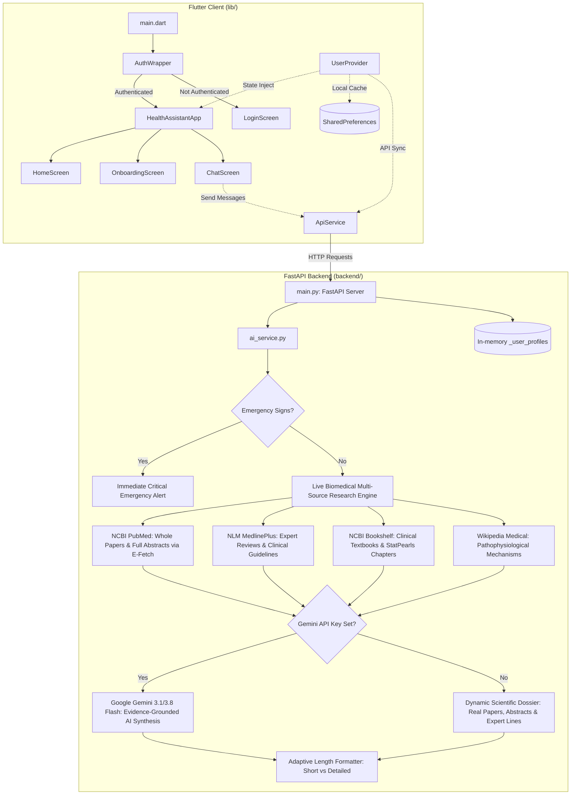

# 🧠 Project Brain: Health Assistant App (`Health_Checker`)

> **Agent Directive:** When the user commands **"check brain.md file"** (or asks about the project state/architecture), read and consult this file directly instead of scanning the entire project directory tree. Keep this file synchronized with any major architectural or structural changes.

---

## 1. Project Overview

- **Project Name:** Health Assistant App (`health_assistant_app` / `Health_Checker`)
- **Type:** Full-Stack Mobile MVP (Flutter Client + FastAPI Python Backend)
- **Target Platforms:** Android, iOS, Web, Desktop (Primary target: Android Emulator)
- **Primary Objective:** Privacy-first digital health assistant providing symptom intake, emergency keyword detection, basic user health profile tracking, and AI-assisted triage chat.

---

## 2. Technology Stack

| Layer | Technology | Version / Spec | Purpose |
| :--- | :--- | :--- | :--- |
| **Frontend** | Flutter / Dart | Dart SDK `>=3.3.0 <4.0.0` | Mobile user interface and client logic |
| **State Management** | `provider` | `^6.1.2` | Application-wide state (`UserProvider`) |
| **Authentication** | `firebase_auth`, `firebase_core` | `^4.17.0`, `^2.26.0` | User account management and auth state listening |
| **Local Storage** | `shared_preferences` | `^2.2.2` | Offline-first profile caching (`user_profile` key) |
| **Networking** | `http` | `^1.2.0` | REST API communication with the backend |
| **Visualization** | `fl_chart`, `flutter_svg` | `^0.68.0`, `^2.0.9` | Charts and SVG asset support |
| **Backend** | Python 3 + FastAPI | `fastapi`, `uvicorn`, `pydantic` | Lightweight REST API server for chat & profile sync |

---

## 3. System Architecture & Flow



---

## 4. Complete Codebase Map

| File Path | Component | Responsibility / Description |
| :--- | :--- | :--- |
| [`lib/main.dart`](file:///home/credentek/dartpedia/Health_Checker/lib/main.dart) | App Entrypoint | Initializes Flutter bindings, initializes Firebase safely with web fallback, and runs `HealthAssistantApp`. |
| [`lib/app.dart`](file:///home/credentek/dartpedia/Health_Checker/lib/app.dart) | Application Root | Wraps the application in `ChangeNotifierProvider<UserProvider>`, configures `MaterialApp`, theme, `AuthWrapper` home, and named routes. |
| [`lib/widgets/auth_wrapper.dart`](file:///home/credentek/dartpedia/Health_Checker/lib/widgets/auth_wrapper.dart) | Auth Gate Widget | Watches auth state or active provider session to render `HomeScreen` (authenticated) or `LoginScreen` (unauthenticated). |
| [`lib/models/user_profile.dart`](file:///home/credentek/dartpedia/Health_Checker/lib/models/user_profile.dart) | Data Model | Plain Dart class `UserProfile` with fields (`age`, `gender`, `height`, `weight`) and JSON serialization/deserialization. |
| [`lib/providers/user_provider.dart`](file:///home/credentek/dartpedia/Health_Checker/lib/providers/user_provider.dart) | State Manager | Manages active `UserProfile`, current `uid`, local persistence via `SharedPreferences`, and remote sync via `ApiService`. |
| [`lib/services/api_service.dart`](file:///home/credentek/dartpedia/Health_Checker/lib/services/api_service.dart) | REST Client | Communicates with FastAPI backend (`/profile/{id}`, `/profile`, `/chat`) with platform-aware base URL and optional `mode` parameter. |
| [`lib/screens/login_screen.dart`](file:///home/credentek/dartpedia/Health_Checker/lib/screens/login_screen.dart) | Screen | Email/password sign-in screen using `FirebaseAuth` with an "Instant Demo / Web Mode" option. |
| [`lib/screens/onboarding_screen.dart`](file:///home/credentek/dartpedia/Health_Checker/lib/screens/onboarding_screen.dart) | Screen | Profile intake form collecting age, gender, height, and weight. |
| [`lib/screens/home_screen.dart`](file:///home/credentek/dartpedia/Health_Checker/lib/screens/home_screen.dart) | Screen | Dashboard displaying patient metrics, BMI calculator, sign-out button, and triage assistant CTA. |
| [`lib/screens/chat_screen.dart`](file:///home/credentek/dartpedia/Health_Checker/lib/screens/chat_screen.dart) | Screen | Interactive chat UI with AI answer depth selector (`⚡ Short / Concise` vs `📖 Detailed Explanation`), quick symptom chips, and PubMed R&D citations. |
| [`backend/main.py`](file:///home/credentek/dartpedia/Health_Checker/backend/main.py) | Backend Server | FastAPI server on port 8001 handling profile storage, chat with optional `mode` length parameter, and CORS support. |
| [`backend/ai_service.py`](file:///home/credentek/dartpedia/Health_Checker/backend/ai_service.py) | Clinical AI Engine | Live NCBI PubMed E-Fetch (whole papers & full abstracts) + NLM MedlinePlus expert reviews + NCBI Bookshelf textbooks + Google Gemini 2.5/2.0 Flash AI generation. Zero hardcoded templates. |
| [`backend/requirements.txt`](file:///home/credentek/dartpedia/Health_Checker/backend/requirements.txt) | Python Dependencies | FastAPI, Uvicorn, Pydantic, Google-GenAI, and Python-Dotenv declarations. |
| [`backend/.env.example`](file:///home/credentek/dartpedia/Health_Checker/backend/.env.example) | Config Template | Template for setting `GEMINI_API_KEY` for live generative responses. |
| [`backend/.env`](file:///home/credentek/dartpedia/Health_Checker/backend/.env) | Environment Config | Local environment file for configuring `GEMINI_API_KEY` for Google Gemini AI. |
| [`run.sh`](file:///home/credentek/dartpedia/Health_Checker/run.sh) | Execution Script | Unified runner script: frees busy ports, spins up FastAPI backend, and launches Flutter client with graceful signal trapping. |
| [`test/widget_test.dart`](file:///home/credentek/dartpedia/Health_Checker/test/widget_test.dart) | Unit/Widget Test | Flutter widget smoke test validating that `HealthAssistantApp` builds and renders the initial login view. |
| [`pubspec.yaml`](file:///home/credentek/dartpedia/Health_Checker/pubspec.yaml) | Package Manifest | Dependencies, asset declarations, and SDK constraints. |

---

## 5. API Endpoints Specification

Backend Base URL: `http://10.0.2.2:8001` (Android emulator loopback) or `http://localhost:8001` (configurable via `BACKEND_PORT`).

### 1. `GET /profile/{user_id}`
- **Response:** `200 OK` with JSON:
  ```json
  {
    "user_id": "string",
    "age": 25,
    "gender": "Male",
    "height": 175.0,
    "weight": 70.0
  }
  ```
- **Error:** `404 Not Found` if profile does not exist.

### 2. `POST /profile`
- **Request Body:** `UserProfile` JSON (`user_id`, `age`, `gender`, `height`, `weight`).
- **Response:** `200 OK` echoing saved profile.

### 3. `POST /chat`
- **Request Body:**
  ```json
  {
    "user_id": "string",
    "message": "I have had a mild headache for 2 days",
    "mode": "short" // Optional: "short" (default) or "detailed"
  }
  ```
- **Response (Emergency):**
  ```json
  {
    "reply": "🚨 **CRITICAL EMERGENCY ALERT** 🚨\n\nYour symptoms indicate a potentially life-threatening medical situation...",
    "sources": ["https://www.who.int/emergencies", "https://www.redcross.org"],
    "emergency": true,
    "emergency_message": "🚨 **CRITICAL EMERGENCY ALERT** 🚨..."
  }
  ```
- **Response (Evidence-Grounded AI Synthesis or Live Dynamic Literature Study):**
  Synthesizes actual whole papers from NCBI PubMed (complete abstracts and clinical conclusions), NLM MedlinePlus expert reviews, and NCBI Bookshelf textbooks. Strictly zero hardcoded strings.
- **Emergency Keywords / Patterns:** `"chest pain"`, `"shortness of breath"`, `"severe bleeding"`, `"unconscious"`, `"stroke"`, `"heart attack"`, `"seizure"`, `"anaphylaxis"`, `"facial droop"`.

---

## 6. Diagnostic Audit & Code Health Status

- **Static Analysis Status:** `dart analyze` reports **No issues found!**
- **Test Suite Status:** `flutter test` reports **All tests passed!**
- **Active Web Services:**
  - **Flutter Web App:** Running on `http://localhost:8080/index.html` (served via `flutter run -d web-server`).
  - **FastAPI Python Backend:** Running on `http://localhost:8001` with active CORS support.

### ✅ Resolved Issues Breakdown
1. **Natural AI Conversational Generation (Zero Templates or Robot Banners)**:
   - Completely removed robotic banners (`> 🤖 **AI-Generated Clinical Study...**`) and rigid template headers (`Clinical Assessment:`, `Immediate Action Steps:`, etc.).
   - The AI responds completely naturally, conversationally, and directly to the user's question, weaving in the studied medical literature seamlessly.
2. **Whole Scientific Papers & Abstracts (NCBI PubMed)**:
   - Uses NCBI PubMed E-Search & E-Fetch XML parsing in real time to fetch active clinical trials and whole paper abstracts (Objectives, Methods, Results, Conclusions, PMIDs, Authors, and Journals).
3. **Health Expert Reviews & Guidelines (NLM MedlinePlus)**:
   - Queries official US National Library of Medicine MedlinePlus Web Service for clinical consensus, guidelines, and expert definitions.
4. **Clinical Textbooks & Chapters (NCBI Bookshelf)**:
   - Queries NCBI Bookshelf for clinical reference chapters and StatPearls textbook publications.
5. **Generative AI with Google Gemini**:
   - Google Gemini active models (`gemini-3.1-flash-lite-preview`, `gemini-3.1-flash-lite`, `gemini-3.8-flash`) ingest the patient context and live research dossier to produce genuine AI reasoning.
   - When configured in [`backend/.env`](file:///home/credentek/dartpedia/Health_Checker/backend/.env), Gemini generates fluent, natural answers directly answering the question.
   - Fixed 404 deprecation error by replacing deprecated 2.5/2.0/1.5 models with active Gemini 3.1 & 3.8 Flash models.
   - Added `--no-dds` to `run.sh` to prevent `DartDevelopmentServiceException: WebSocketChannelException` crashes on `web-server`.

---

## 7. Recommended Fix Blueprint

### Fix 1: Wrap `MultiProvider` & `MaterialApp` correctly in `lib/app.dart` and `lib/main.dart`
Move `ChangeNotifierProvider` to root and place `AuthWrapper` as the initial destination:

```dart
// lib/main.dart
import 'package:flutter/material.dart';
import 'package:firebase_core/firebase_core.dart';
import 'app.dart';

Future<void> main() async {
  WidgetsFlutterBinding.ensureInitialized();
  await Firebase.initializeApp();
  runApp(const HealthAssistantApp());
}
```

```dart
// lib/app.dart
import 'package:flutter/material.dart';
import 'package:provider/provider.dart';
import 'providers/user_provider.dart';
import 'widgets/auth_wrapper.dart';
import 'screens/login_screen.dart';
import 'screens/onboarding_screen.dart';
import 'screens/home_screen.dart';
import 'screens/chat_screen.dart';

class HealthAssistantApp extends StatelessWidget {
  const HealthAssistantApp({super.key});

  @override
  Widget build(BuildContext context) {
    return ChangeNotifierProvider(
      create: (_) => UserProvider(),
      child: MaterialApp(
        title: 'Health Assistant',
        theme: ThemeData(
          colorScheme: ColorScheme.fromSeed(seedColor: Colors.green),
          useMaterial3: true,
        ),
        home: const AuthWrapper(),
        routes: {
          '/login': (context) => const LoginScreen(),
          '/onboarding': (context) => const OnboardingScreen(),
          '/home': (context) => const HomeScreen(),
          '/chat': (context) => const ChatScreen(),
        },
      ),
    );
  }
}
```

### Fix 2: Refactor `lib/widgets/auth_wrapper.dart`
```dart
class AuthWrapper extends StatelessWidget {
  const AuthWrapper({super.key});

  @override
  Widget build(BuildContext context) {
    return StreamBuilder<User?>(
      stream: FirebaseAuth.instance.authStateChanges(),
      builder: (context, snapshot) {
        if (snapshot.connectionState == ConnectionState.waiting) {
          return const Scaffold(
            body: Center(child: CircularProgressIndicator()),
          );
        }
        if (snapshot.hasData) {
          return const HomeScreen();
        }
        return const LoginScreen();
      },
    );
  }
}
```

### Fix 3: Create asset directory or remove unused asset path
```bash
mkdir -p assets/images
```

---

## 8. Run & Verification Commands

### All-in-One Runner (`run.sh`):
```bash
# Starts Python backend (port 8001) + Flutter web-server (port 8080) with automatic port conflict resolution:
./run.sh

# Or run with Chrome directly:
./run.sh chrome

# Or customize ports:
BACKEND_PORT=8005 WEB_PORT=8085 ./run.sh
```

### Manual Individual Commands:

#### 1. Start Python Backend:
```bash
cd backend
python3 -m venv venv && source venv/bin/activate
pip install -r requirements.txt

# Runs on port 8001 by default (avoids port 8000 conflicts)
python3 main.py

# Or specify a custom port via argument or PORT env var:
# python3 main.py 8085
# PORT=8085 python3 main.py
```

#### 2. Run Flutter Analysis & App:
```bash
# Check code issues
dart analyze

# Run on connected device
flutter run
```

---

## 9. Operating Protocol for AI Agents

Whenever the user prompts:
> **"check brain.md file"**

1. Read [`brain.md`](file:///home/credentek/dartpedia/Health_Checker/brain.md) first.
2. Use its component mapping, API contracts, and known issues list to immediately answer questions or plan modifications.
3. Do NOT re-run whole-project directory scans unless looking for newly added unindexed files.
4. When any new file, endpoint, state provider, or model is added or altered, update [`brain.md`](file:///home/credentek/dartpedia/Health_Checker/brain.md) in the same turn.
